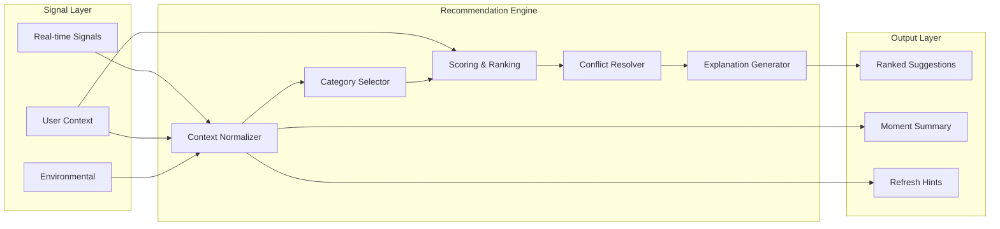

# Contextual Recommendation Engine — System Framework

## Product principle

Recommendations must feel **timed to the exact moment**, not retrieved from a static "Top 10" list. The same user in Kyoto at **2 PM sunny Saturday** should see a fundamentally different feed than at **9 PM rainy Tuesday**.

**Route (demo):** `/features/contextual-recommendations`  
**API:** `POST /api/recommendations/contextual` → Flask `5011`

---

## 1. Architecture overview



---

## 2. What triggers a refresh?

Recommendations regenerate when **any material signal changes**. Use a *context fingerprint* (hash of normalized signals); refresh when fingerprint differs.

| Trigger | Threshold | Priority |
|---------|-----------|----------|
| **Time band change** | Crosses morning → afternoon → evening → late_night | High |
| **Weather condition change** | clear ↔ rain ↔ snow ↔ extreme_heat | High |
| **Precipitation spike** | +20% rain probability or active precipitation | High |
| **Location shift** | >500 m from last fix | Medium |
| **Activity state change** | moving ↔ stationary ↔ transitioning | Medium |
| **Nearby event start** | Event within 2 km starting in <60 min | Medium |
| **Crowd surge** | Venue crowd level jumps a tier | Low |
| **Budget/session change** | User updates budget or group size | High |
| **Explicit refresh** | Pull-to-refresh / "Surprise me" | Immediate |
| **Session heartbeat** | Every 15 min if app foregrounded | Low (re-rank only) |

**Rule:** Never show stale cards without a "Updated for rain / evening" banner when context shifted.

---

## 3. Signal categories & normalization

### 3.1 Environmental factors

| Signal | Source | Normalized values |
|--------|--------|-------------------|
| Time of day | Device clock + timezone | `morning` (6–11), `afternoon` (11–17), `evening` (17–21), `late_night` (21–6) |
| Weather | OpenWeather / demo override | `clear`, `cloudy`, `rain`, `snow`, `extreme_heat`, `windy` |
| Temperature | Weather API | °C bucket: cold (<8), mild, warm (>28) |
| Season | Date + hemisphere | `spring`, `summer`, `autumn`, `winter` |
| Day type | Calendar | `weekday`, `weekend`, `holiday` |

### 3.2 User context

| Signal | Source | Use |
|--------|--------|-----|
| Preferences | Onboarding / history | outdoor, food, culture, nightlife, wellness tags |
| Budget tier | Budget engine / manual | `budget`, `mid`, `luxury` — filters + soft scoring |
| Group size | Trip profile | solo, couple, family, group — capacity match |
| Travel history | Past clicks / visits | novelty vs familiarity balance |
| Dietary | Profile | vegetarian, halal — hard filter where needed |
| User archetype | Inferred or selected | See §7 |

### 3.3 Real-time signals

| Signal | Source | Use |
|--------|--------|-----|
| GPS / neighborhood | Device | Distance decay, "nearby now" vs "worth the trip" |
| Activity state | Motion / manual | moving → quick stops; stationary → longer experiences |
| Active events | Events API / festivals service | Boost time-sensitive matches |
| Crowd density | Historical + live estimates | Penalize packed venues when user prefers calm |
| Availability | Booking APIs / heuristics | `open_now`, `walk_in`, `booking_required`, `sold_out` |

---

## 4. Data flow: signals → suggestions

```
1. INGEST     Collect raw signals (API + device + profile)
2. NORMALIZE  Map to canonical enums + compute context_fingerprint
3. SELECT     Pick 2–4 primary categories for THIS moment (§5)
4. CANDIDATE  Pull venue pool for city; hard-filter (closed, budget, dietary)
5. SCORE      Weighted multi-factor score per candidate (§6)
6. RESOLVE    Apply conflict rules (outdoor pref + rain → §6.3)
7. DIVERSIFY  MMR diversity — avoid 5 identical izakayas
8. EXPLAIN    Attach "why now" string tied to active signals
9. EMIT       Top 5–8 cards + moment_summary + next_refresh_hint
```

---

## 5. Category selection (moment → intent)

The engine first decides **what kind of suggestions** fit the moment, then ranks venues inside those categories.

| Condition combination | Primary categories | Deprioritize |
|----------------------|-------------------|--------------|
| Rain + evening | Cozy indoor, food, culture (museums) | Outdoor temples, long walks |
| Clear + afternoon + weekend | Outdoor, markets, viewpoints | Late-night bars |
| Late night + stationary | Night food, lit districts, convenience | Museums, parks |
| Moving + rain | Nearby (<1 km), quick, covered | 45+ min experiences |
| Snow + family | Indoor play, warm cafés, short outdoor | Long hikes |
| Extreme heat + afternoon | AC venues, pools, siesta-friendly | Open-air midday |
| Event starting soon | Event venue + pre/post food | Generic sightseeing |

**Category weights** shift dynamically — not fixed 33/33/33 across environmental/user/realtime.

---

## 6. Scoring & weighting logic

### 6.1 Base formula

```
final_score = (
  W_env  × env_match +
  W_user × user_match +
  W_rt   × realtime_match
) × availability_multiplier
```

**Default weights (adjust by archetype — §7):**

| Layer | Weight | Sub-factors |
|-------|--------|-------------|
| Environmental | 0.35 | weather_fit 0.15, time_fit 0.12, season_fit 0.08 |
| User | 0.30 | preference_overlap 0.15, budget_fit 0.08, group_fit 0.07 |
| Real-time | 0.35 | distance 0.12, open_now 0.10, crowd_fit 0.08, event_boost 0.05 |

Each sub-factor is **0.0–1.0** from venue attribute tags.

### 6.2 Distance decay

```
distance_score = exp(-distance_km / decay_km)
```
- `moving`: decay_km = 0.8 (strong nearby bias)
- `stationary`: decay_km = 2.5 (willing to travel)
- `transitioning`: decay_km = 1.5

### 6.3 Conflict resolution

When signals conflict, **never silently ignore** — resolve with explicit trade-offs and copy.

| Conflict | Resolution strategy |
|----------|---------------------|
| Outdoor pref + rain | Score outdoor venues ×0.4; boost `rain_ok` / indoor ×1.3; explain: *"Rain now — these covered picks match your outdoor vibe"* |
| Budget low + luxury venue | Hard exclude above tier; surface best value in category |
| Late night + museum | Hard exclude (closed); pivot to night-food / lit walks |
| Family + nightlife | Exclude 21+ venues; boost family tags |
| Crowd-averse + peak hour | Penalize `crowd: high`; boost `crowd: low` or off-peak timing tip |
| Event sold out | Remove; promote "plan B" same category nearby |

**Principle:** Preferences are *soft* unless safety/dietary/closed; environment and availability are *hard* when blocking.

### 6.4 What makes a suggestion feel responsive?

1. **Moment headline** — "Rainy Tuesday, 9 PM in Kyoto" not "Recommendations"
2. **Why-now line** on every card — ties to ≥1 live signal
3. **Visible refresh** — subtle pulse when context changes
4. **Contrast proof** — demo toggle shows feed swap (same city, different moment)
5. **Timing hints** — "Best in the next 90 min" / "Last entry at 8 PM"
6. **No generic duplicates** — diversity across categories in top 5

---

## 7. User archetypes

| Archetype | Weight shifts | Moment behavior |
|-----------|---------------|-----------------|
| **Spontaneous Explorer** | +novelty, +realtime, −plan_required | Loves "open now" & surprise pivots |
| **Methodical Planner** | +availability certainty, +reviews, −crowd | Prefers bookable, low-variance picks |
| **Budget Backpacker** | +budget_fit, +free, +walkable | Rain → free museums over paid tours |
| **Family Navigator** | +group_fit, +duration<90, +accessibility | Evening → early dinner, not bars |
| **Luxury Seeker** | +premium tier, +exclusivity | Rain → spa / omakase over casual |
| **Digital Nomad** | +wifi, +café, stationary midday boost | Moving → skip laptop venues |
| **Culture Deep-Diver** | +culture, +local-only | Weather less important for museums |

Archetype modifies **W_user** sub-weights, not hard filters (except family → no bars).

---

## 8. Weather API integration

```
GET weather(lat, lon) → { condition, temp_c, precip_prob, wind }
```

| Weather | Venue tag boosts | Venue tag penalties |
|---------|------------------|---------------------|
| Rain | `indoor`, `covered`, `rain_ok` | `outdoor_only`, `garden_primary` |
| Snow | `heated`, `indoor`, `short_outdoor` | `steep_paths`, `open_air_market` |
| Extreme heat | `air_conditioned`, `evening_outdoor` | `midday_outdoor`, `long_walk` |
| Clear + mild | `outdoor`, `viewpoint`, `walk` | — |
| Windy | `sheltered`, `indoor` | `rooftop`, `boat` |

**Integration point:** Weather feeds **environmental layer only**; user prefs can partially override with conflict resolution (§6.3).

**Fallback:** Seasonal averages from `weather.json` when live API unavailable (demo mode).

---

## 9. Refresh & session behavior

| Mode | Behavior |
|------|----------|
| **Cold open** | Full pipeline; show skeleton → cards |
| **Context shift** | Diff old vs new fingerprint; animate changed slots |
| **Background return** | Re-fetch if >10 min or fingerprint stale |
| **Debounce** | GPS updates debounced 30s to avoid flicker |

Return payload includes:
- `context_fingerprint`
- `moment_summary` (human-readable)
- `primary_categories[]`
- `recommendations[]` with `score`, `why_now`, `signals_used[]`
- `next_refresh_hint` ("Updates when weather clears or after 9 PM")

---

## 10. Example: Kyoto contrast

### Scenario A — Tuesday 9 PM, rain, stationary, couple, mid budget

**Categories:** cozy food, covered culture, night stroll (lit)  
**Top picks:**
1. Ponto-chō covered alley izakaya walk — *Rain-safe; lanterns peak after 8 PM*
2. Nishiki Market adjacent covered arcades — *Still browsing under roof until late*
3. Jazz bar near Kawaramachi — *Indoor, couple-friendly, open past 10*

### Scenario B — Saturday 2 PM, clear, moving, solo explorer

**Categories:** outdoor temples, viewpoints, street food  
**Top picks:**
1. Fushimi Inari early-tier gates — *Clear afternoon light; go before 4 PM crowds*
2. Philosopher's Path → Ginkaku-ji — *Best walked in sunshine; 2 km loop*
3. Nishiki outer stalls — *Quick bite while moving; no sit-down needed*

**Same city. Zero overlap in top 3.** That's the bar.

---

## 11. Integration with Ainomad

| Existing feature | Feeds recommendations |
|------------------|-------------------------|
| Smart Budget | Budget tier, overspend risk → suppress premium |
| Emergency Companion | Severe weather / safety → suppress risky outdoor |
| Cultural Intelligence | Active festivals → event_boost |
| Readiness / Weather JSON | Seasonal fallback |
| Itinerary | Deprioritize duplicates already scheduled today |

---

## 12. Implementation files

| File | Role |
|------|------|
| `features/contextual-recommendations/FRAMEWORK.md` | This document |
| `backend/services/recommendations/app.py` | Scoring engine |
| `backend/data/recommendation_venues.json` | Tagged venue catalog |
| `frontend/app/features/contextual-recommendations/page.jsx` | Live moment demo |

---

## 13. Future extensions

- Collaborative filtering from community feed clicks
- LLM explanation layer (Groq) on top of structured scores
- Push notifications on context shift ("Rain starting — 3 indoor picks near you")
- Booking deep-links when availability confirms open slots
